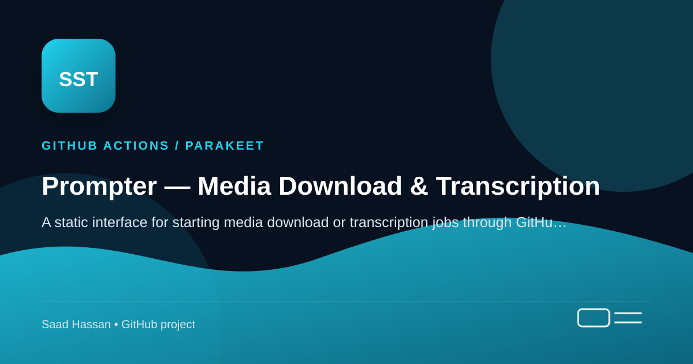

# Prompter Studio

A single workspace for video/audio -> timed transcript -> translation -> subtitles -> captioned MP4, in navy, cream and coral. The frontend stays on GitHub Pages. Existing media downloads and AI tools remain available.

## Run locally on this machine

From the SAM Audio folder:

```powershell
Set-Location "S:\Work\Sam Audio 3D"
.\start.ps1 -Studio
```

Or from this repository:

```powershell
Set-Location "S:\Work\SST"
.\start-studio.ps1
```

Open **http://127.0.0.1:8765**. Keep the terminal open; Ctrl+C stops the server. The original SAM-only UI still starts with `start.ps1` without `-Studio`.

The launcher uses the existing SAM Audio Python environment and model cache on E:. Set `SAM_AUDIO_ROOT` if that project moves. SAM code and weights are not copied into this repository. Large is selected by default in the studio; text, positive/negative spans, fixed boxes and uploaded image/video masks can be combined. White in masks means keep the object. Automatic SAM 3 tracking remains a separate preprocessing step.

The NVIDIA key is read from the ignored `worker/.dev.vars` file or `NVIDIA_API_KEY` environment variable. It is never sent to the browser. The local server binds to 127.0.0.1 and accepts writes only from its own origin. Media/results are stored under ignored `work/studio/`; they remain until you delete them.

For a fresh machine, install the separate multilingual client after the SAM environment is set up:

```powershell
uv venv --python "S:\Work\Sam Audio 3D\.venv\Scripts\python.exe" .venv
uv pip install --python .venv/Scripts/python.exe nvidia-riva-client==2.28.0
```

This small environment isolates Riva's newer protobuf requirements from SAM Audio's older dependencies. It downloads no model weights.

## Delivery and finding tools

Open **All tools** in the navigation, or `all-tools.html`, for a searchable directory with descriptions and direct links to all 18 tools. The directory labels SAM Audio as local-only. Studio and advanced AI tools show animated, accessible processing indicators, with reduced-motion support.

Uploaded recordings have two delivery modes:

- **Wait here:** watch server progress and download the finished transcript and subtitle files.
- **Email me the results:** enter a recipient, optionally select transcript/subtitle translation, and start. Keep the tab open while audio is prepared and every chunk is uploaded. Only after the complete upload is sealed does the interface confirm it is safe to close. Processing then runs independently of the browser.

Both web delivery modes use the private background processor for the entire recording. The email includes TXT/SRT/VTT attachments (including translated files when selected), plus a saved result link available for three days. Recipient addresses and upload tokens are excluded from public status and dispatch payloads. Addresses are cleared after the notification attempt. SMTP failures do not discard completed results; the saved page reports the failure and offers downloads. Incomplete uploads expire after 30 minutes; queued/active processing times out after 45 minutes. Input audio is deleted on completion, failure or timeout. Result pages can be reopened through `?media_job=<uuid>`, including from a different browser.

The existing repository `GMAIL_USERNAME` and `GMAIL_APP_PASSWORD` secrets provide the sender; each user supplies their own recipient in the form. `.github/workflows/media.yml` transcribes with NVIDIA, optionally translates while preserving cue boundaries, and uses the same email sender as the legacy link workflow. The recipient never appears in Actions dispatches, releases, or logs. Email delivery was verified through mocked SMTP composition/attachment/failure tests; no unsolicited live test message is sent.

Background recordings are limited to **20 minutes**. Browser source files can be up to 250 MB; the local studio extracts audio with native FFmpeg for sources up to 1 GB. Local email mode forwards only audio to the same remote processor; SAM separation and video rendering still run locally. Captioned MP4 rendering needs the original video in the open browser or local app, so result emails contain transcript/subtitle files rather than a rendered video.

## The workflow

1. Choose or drop a video/audio file. Preview it immediately, or import SRT/VTT/TXT.
2. Choose Auto, Parakeet (English) or NVIDIA-hosted Whisper Large v3 (multilingual), both locally and on the deployed website. Edit SRT directly or seek through the timed view.
3. Translate the original transcript; cue boundaries and speaker labels are preserved. Riva is used for supported language pairs, and a text model for auto-detection/Urdu and other unsupported pairs. Changing the source marks its previous translation as stale.
4. Choose the original or translated subtitle track. Preview captions, download SRT/VTT/TXT, or render a captioned MP4. Translation changes subtitle text, not the spoken audio.
5. Optionally isolate a sound with local SAM Audio and download target/residual WAVs and videos.

Parakeet supplies real word timestamps. The hosted Whisper endpoint returned no word timestamps in live checks, so multilingual Whisper transcription uses explicitly labelled **approximate 8-second segment timing**. Review those timings against the video before export. Imported timings are retained. Plain TXT is never silently assigned invented timestamps.

Text drafts are saved in sessionStorage for this browser tab; media files must be selected again after refresh. NVIDIA receives audio for transcription and text for translation under its API terms. Local video and SAM processing stay on your machine. Browser previews use a styled overlay plus an accessible VTT track.

## GitHub Pages behavior

- Uploads: up to 250 MB in the browser; up to 1 GB with the local backend.
- Web upload transcription: choose Parakeet for English or Whisper Large v3 for multilingual input. All audio chunks upload first, then a private GitHub Actions/NVIDIA job processes the complete recording. Choose wait or email delivery, with optional translation. Background results are retained for three days. The original one-chunk Whisper endpoint remains available for older clients.
- Captioned MP4: renders in-browser with single-thread ffmpeg.wasm, without requiring cross-origin isolation headers unavailable on Pages. First use downloads ~31 MB from the pinned jsDelivr package and open Noto subtitle fonts from their source repositories. Extra script fonts load only when needed. Browser export supports up to 250 MB inputs, up to 40 KB subtitles, and a 30-minute render timeout. Local exports use native FFmpeg.
- SAM Audio: visibly disabled on GitHub Pages. Even a static localhost preview cannot enable it; the same-origin local backend must report it available.
- `download.html` keeps the original public-link/Actions workflow. Old root `?job=` links redirect there. Completed jobs can open the new studio using `?source_job=` with their timestamps intact. `tools/` retains the existing advanced AI tools and uses the same theme.

### Publish the update

The frontend uses the existing GitHub Pages branch (`main`, `/docs`). Deploy the Worker first, then push the frontend and the Actions workflows (`whisper.yml` and `media.yml`). No hosting migration is needed.

```powershell
npx wrangler login
npx wrangler secret put NVIDIA_API_KEY --config worker/wrangler.toml
# Paste the key at the prompt. Keep it out of public files and command arguments.
npx wrangler deploy --config worker/wrangler.toml
```

The Whisper bridge requires `WHISPER_BRIDGE_KEY` in both Worker and repository secrets, and `NVIDIA_API_KEY` in repository secrets as well as the Worker. These are server-side secrets. The local studio reads the ignored development configuration. The public UI never receives either credential.

## Checks

```powershell
npm ci
npm test
npm run check:worker
npm run test:browser
npm run test:studio
```

The Whisper runner workflow installs only the Riva client; inference runs on NVIDIA GPUs, not GitHub Actions.

Browser fixtures live in ignored `.wrangler/test-media/`; see `.github/workflows/check.yml` for generation commands. `test:studio` exercises audio decoding, timed transcription/translation, Arabic subtitle rendering into an actual MP4 with the real WASM core, draft restore, mobile layout and local capability gating. It uses deterministic model responses; live synthetic-content checks also passed NVIDIA speech/translation and local SAM Large through the new adapter.

The retained downloader and advanced-tool implementation details follow.

---

<!-- Project cover -->
<p align="center">
  
</p>

> **GitHub Actions / Parakeet** — A static interface for starting media download or transcription jobs through GitHub Actions.

## Project snapshot

- A Cloudflare Worker protects the GitHub token while releases provide job-status results.
- Includes a root-level <a href="./project-cover.svg">project-cover.svg</a>, a scalable project cover graphic for this repository.

---

# Prompter — download & transcribe media over GitHub Actions

## NVIDIA AI transform tools

The production tools live in `docs/tools/` and are linked from the homepage and
each completed transcript. The implementation uses the PDF and prototype in
`prompter-nvidia-tools/` as references; the prototype remains separate.

Available features:

- Summary, chapters and key moments; transcript and timed-subtitle translation.
- Semantic search and transcript chat with source passages and supplied timestamps.
- Editable content repurposing, JSON meeting/podcast notes, ranked clip suggestions.
- AI caption line segmentation, SRT/VTT exports, translated video caption preview.
- Image descriptions/alt text, sampled video Q&A, and content safety classification.
- Styled captions burned into a downloadable MP4 through the existing Actions queue.

Downloads, Parakeet transcription, diarization, notifications, and existing `?job=`
links continue to use their original routes. The Worker adds `/ai/config`,
`POST /ai/jobs`, and `GET /ai/jobs/<uuid>`. AI calls use persistent SQLite-backed
Durable Objects and alarms, with a 240-second timeout per model attempt, at most
three attempts, scheduled backoff, a restart watchdog, and a 15-minute job window.
NVIDIA HTTP 202 responses are polled by request ID rather than resubmitted.
Refreshing a tab can
resume the saved operation without resubmitting finished batches. Each individual
AI job has a shareable result link that expires after 24 hours.

The API key stays in the Worker's `NVIDIA_API_KEY` secret. The supplied development
key is in the ignored `worker/.dev.vars`; it is never shipped in browser assets.
AI inference has a separate atomic limit of 120 submissions per IP per hour and a
shared budget of 30 NVIDIA requests/minute. Matching results are cached privately
by input hash for 24 hours; malformed structured outputs can bypass this cache on
retry. Requests are validated against a model allowlist, and specialized models
never silently fall back to generic chat models.
Nemotron thinking mode is disabled for these user-facing transforms so structured
caption/notes requests return final answers within their output-token budgets.

Riva's documented language pairs use explicit system tags and English pivoting.
Auto-detection, Urdu, Persian and Malay use the chat model. Riva subtitle batches
use a single line with checked cue markers: a multiline batch dropped a cue in
live testing. Translations preserve original cue boundaries and `Speaker N:` labels.
Plain text has approximate subtitle timing. Long text tools process all supplied
text in parts; they reject inputs above 170,000 characters with a clear message.

Caption exports accept public media links and up to 40 KB of timed SRT, with
classic, bold and minimal styles. Local videos can be previewed, but a remote
export requires a public link. Exported videos and SRT are public release assets,
as with existing jobs. NVIDIA trial processing/recording is disclosed on the page.

Dubbing, audio cleanup and synthetic-video detection need additional NVIDIA
access or separately hosted services; they are explicitly unavailable in the UI.
Pose tracking and live voice remain parked as specified by the PDF.

### Deploy these changes

Deploy the additive Worker before publishing the frontend. The existing GitHub
and Turnstile secrets are preserved by `wrangler deploy`.

```powershell
npm ci
npx wrangler login
npx wrangler secret put NVIDIA_API_KEY --config worker/wrangler.toml
# Paste the NVIDIA key at the prompt; do not put it in a command or public config.
npx wrangler deploy --config worker/wrangler.toml
```

Publish the changed `docs/`, `.github/workflows/process.yml`, and
`scripts/caption.py` together on the default branch using the existing GitHub
Pages deployment. The workflow needs to support the new `captions` dispatch before
using caption exports. No hosting migration is required. If enabling Turnstile,
keep `turnstileSiteKey` in `docs/tools/js/config.js` consistent with the homepage.

### Verify locally

```powershell
npm ci
npm test
npm run check:worker
# Browser checks use Chromium, or installed Microsoft Edge as a fallback.
npx playwright install chromium
# Generate the small video fixture required by browser sampling checks:
New-Item -ItemType Directory -Force .wrangler/test-media | Out-Null
ffmpeg -hide_banner -loglevel error -y -f lavfi -i testsrc=size=160x90:rate=10 -t 1 -pix_fmt yuv420p .wrangler/test-media/sample.mp4
npm run test:browser
```

Optional real endpoint checks require Python `requests` and the ignored local key:
`python tests/nvidia-smoke.py`. To check persistent job execution, run
`npm run dev:worker -- --var ALLOWED_ORIGIN:http://127.0.0.1:8765`, then
`python tests/local-worker-smoke.py` or `node tests/browser-smoke.cjs --live` in
another terminal. Live checks submit only synthetic test content.

Validated on 2026-10-05: 18 Node tests and 3 Python tests, desktop/mobile browser
regressions, actual ffmpeg caption rendering, live summary/translation/embedding/
safety responses, and real browser-to-Worker-to-NVIDIA background execution.


Paste a video link on a static web page; a remote GitHub Actions runner downloads
the video (at a chosen quality) or transcribes it with **NVIDIA Parakeet TDT**, and
the result comes back to the page. No server of your own beyond a tiny Cloudflare
Worker that keeps your GitHub token safe.

The page follows the visitor's light/dark system theme. While a job runs it shows a
live stage (downloading → transcribing → uploading), and the URL becomes a shareable
`?job=<id>` permalink you can bookmark or send to someone — reopening it re-polls and
shows the result. Failures surface the real reason (private video, unavailable,
members-only, …) rather than a generic error.

## How it works

```
Browser (GitHub Pages)  ──POST /trigger──►  Cloudflare Worker  ──repository_dispatch──►  GitHub Actions
        ▲                                    (holds the token)                                │
        │                                                                                     │ runs yt-dlp / Parakeet
        └──────────GET /status (poll)──────  Worker reads the Release  ◄──uploads asset──  GitHub Release (job-<id>)
```

- The **Worker** is the only thing that talks to the GitHub API. Your token lives
  there as a secret, never in the browser.
- Each job creates a **Release** tagged `job-<id>`. Its notes are the status channel the
  page polls: `status:` is queued (no release) / running / done / error, `stage:` carries
  the live sub-step, and `mode:` lets a shared `?job=` link render without prior context.
  **Done is keyed off `status: done` in the notes, written only after every asset is
  uploaded** — so a poll landing mid-upload never reports a half-finished job.
- On failure, the scripts write a one-line human reason to `ERROR.txt`; the Worker returns
  it as the error message the page shows.
- **Video** comes back as a download link (release asset). **Transcripts** are shown
  inline on the page and offered as `.txt` / `.srt`.

## Transcription & diarization

Transcribe mode always writes `<name>.txt` and `<name>.srt`. Tick **Label speakers** and
it *additionally* writes `<name>.diarized.txt` and `<name>.diarized.srt`, with every turn
prefixed `Speaker 1:` / `Speaker 2:` / …

- **The speaker count is required in the UI** (1–20). An exact count is noticeably more
  accurate than auto-detection. `transcribe.py` still accepts `--speakers 0` to
  auto-detect for local runs, tuned with `--cluster-threshold`.
- **The plain transcript is written before diarization starts**, so a diarization failure
  can't cost you the transcript.
- **Speaker numbers are arbitrary and per-file.** Diarization works out how many voices
  there are and when each is speaking — not who they are. "Speaker 1" in two different
  jobs is not the same person.
- **Expect roughly double the job time**: a segmentation pass, embedding extraction and
  clustering on top of transcription, on 2–4 vCPUs.
- **Overlapping speech is the weak spot** of any clustering diarizer — expect smearing
  where people talk over each other.
- Models are pyannote segmentation 3.0 (~7 MB) plus NeMo TitaNet-small embeddings
  (~40 MB), pulled from sherpa-onnx's GitHub releases — no Hugging Face token and no
  PyTorch. Cached in `models/` (gitignored) and cached in CI under its own key.

## Repo layout

```
.github/workflows/process.yml   the Actions job (download + transcribe)
scripts/fetch.py                yt-dlp download (video preset or audio-only)
scripts/transcribe.py           Parakeet TDT + Silero VAD -> .txt / .srt
requirements.txt                transcription deps (CPU)
worker/worker.js                Cloudflare Worker (the secure relay)
worker/wrangler.toml            Worker config
docs/index.html                 the GitHub Pages frontend
```

## Setup

### 1. Create the repo
Create a **public** repo and add these files. Everything runs from the **default
branch** — `repository_dispatch` only triggers workflows on the default branch, so the
workflow file must live there.

### 2. Enable GitHub Pages
Settings → Pages → Build and deployment → Deploy from a branch → branch `main`, folder
`/docs`. Note the published URL, e.g. `https://USERNAME.github.io/REPO/`. The origin
you'll need later is just `https://USERNAME.github.io`.

### 3. Create a token for the Worker
Create a **fine-grained personal access token** (Settings → Developer settings →
Fine-grained tokens):
- Repository access: only this repo.
- Permissions: **Contents → Read and write** (this one permission covers both firing
  `repository_dispatch` and reading releases).

The workflow itself does **not** need this token — it uses the built-in `GITHUB_TOKEN`.
The PAT is only for the Worker.

### 4. Deploy the Worker
```bash
npm install -g wrangler
cd worker

# edit wrangler.toml: set GITHUB_OWNER, GITHUB_REPO, ALLOWED_ORIGIN
wrangler login
wrangler secret put GITHUB_TOKEN      # paste the fine-grained PAT
wrangler deploy
```
Copy the deployed URL (e.g. `https://yt-actions-relay.<subdomain>.workers.dev`).

### 5. Point the frontend at the Worker
In `docs/index.html`, edit the CONFIG block near the bottom:
```js
const WORKER_URL = "https://yt-actions-relay.<subdomain>.workers.dev";
const REPO_URL   = "https://github.com/USERNAME/REPO";
```
Commit. Once Pages redeploys, open the Pages URL and try a link.

## Optional hardening (recommended for anything public)

### Bot check (Cloudflare Turnstile)
1. Create a Turnstile widget (free) and note the **site key** and **secret key**.
2. Put the site key in `docs/index.html` → `TURNSTILE_SITE_KEY`.
3. Set the secret on the Worker: `wrangler secret put TURNSTILE_SECRET`, then `wrangler deploy`.

Keep these consistent: only set the Worker secret **if** the frontend has a site key.
(Secret set but no site key ⇒ every request fails verification.)

### Per-IP rate limit — **already on in this repo**
The `RATE_LIMIT` KV namespace is created and bound in `worker/wrangler.toml`, capped by
`RATE_LIMIT_PER_HOUR` (currently 10). Setting it up from scratch elsewhere:
```bash
cd worker
wrangler kv namespace create RATE_LIMIT   # copy the id it prints
# paste the id into the [[kv_namespaces]] block in wrangler.toml
wrangler deploy                           # the cap is not live until you deploy
```
The Worker skips rate limiting entirely when the binding is absent, so deleting that
block silently reopens the hole rather than failing loudly.

**Caveat:** KV reads are eventually consistent (~60s), so this caps sustained abuse, not
a parallel burst — several simultaneous requests can each read a stale count and pass.
For a hard cap, switch to Cloudflare's native rate-limiting binding, which is atomic.

### Release cleanup
`.github/workflows/cleanup.yml` deletes `job-*` releases (and their tags) older than 3
days, nightly. Run it manually from the Actions tab with `dry_run` first to preview.
Keep retention above `process.yml`'s 350-minute timeout so it can't delete a release
belonging to a job that is still running.

## Costs & limits
- **Free** on a public repo (unlimited Actions minutes on standard runners).
- Runners are ~2 vCPU, so transcription runs slower than your laptop — still far under
  the **6-hour per-job cap**. Parakeet at ~0.3–0.5 RTF on a runner means an hour of
  audio in well under an hour.
- GitHub allows ~20 concurrent jobs on free public repos — a natural throttle.

## YouTube is not supported

YouTube blocks the datacenter IP ranges GitHub Actions runners come from ("Sign in to
confirm you're not a bot"). Both the frontend and the Worker reject YouTube links up
front with an explanation, instead of queueing a job that can only fail.

**Don't try to fix this with cookies, PO tokens, or `player_client` tricks.** They buy
account access and bot attestation — not IP reputation. yt-dlp's maintainers file the
logged-out datacenter-IP block under *intractable issues* and state that a PO token will
not help if your IP is already blocked. Account cookies additionally stop working within
days and carry a real risk of the account being banned, so they cannot run unattended.
This was researched and settled; the scaffolding in `fetch.py` predates that finding.

The only lever that changes the outcome is not using a datacenter IP — a self-hosted
runner on a residential connection, or a residential proxy via `YTDLP_PROXY`. Both were
considered and declined: the runner would execute strangers' URLs on a home network, and
a metered proxy lets anyone run up an unbounded bill on a free public tool.

## Optional yt-dlp network config

`process.yml` reads three optional settings and no-ops when they're unset:

| Name | Kind | Purpose |
|---|---|---|
| `YT_COOKIES_B64` | secret | base64 of a Netscape `cookies.txt`, for age-restricted or private content **on sites other than YouTube** |
| `YTDLP_PROXY` | secret | proxy URL (may embed credentials) |
| `YTDLP_PLAYER_CLIENT` | variable | comma-separated yt-dlp player clients |

The cookies file is written to `$RUNNER_TEMP`, never the workspace — anything under
`output/` is swept up by `gh release upload output/*` and would be published.

## Notes
- **Keep yt-dlp current.** The workflow installs the latest each run; most "can't
  download" errors are stale-extractor issues fixed by updating.
- **Quality presets** (best / 1080p / 720p / 480p / 360p) are fixed for v1; yt-dlp picks
  the closest match. Per-video format listing can be added later.
- Test the transcription logic locally first with the companion notebook before relying
  on it in Actions.
